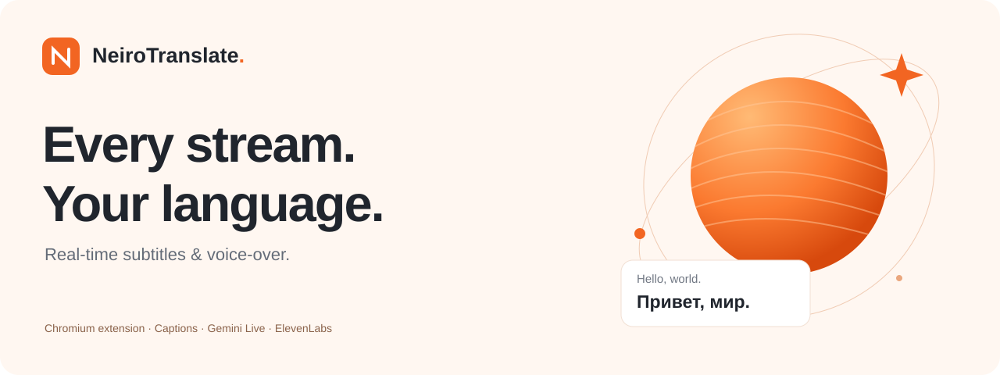
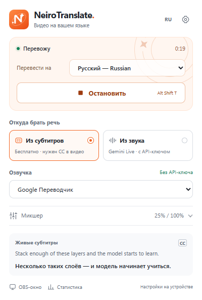
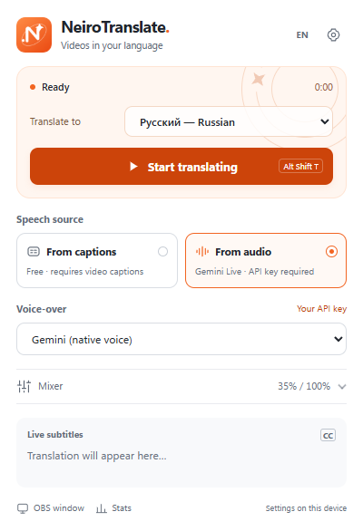
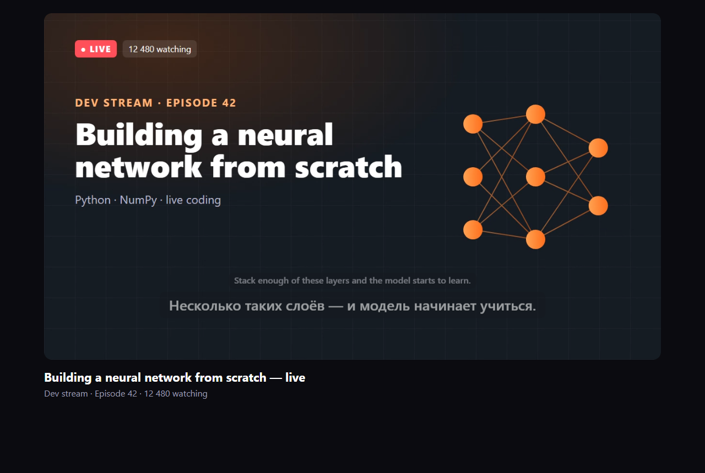
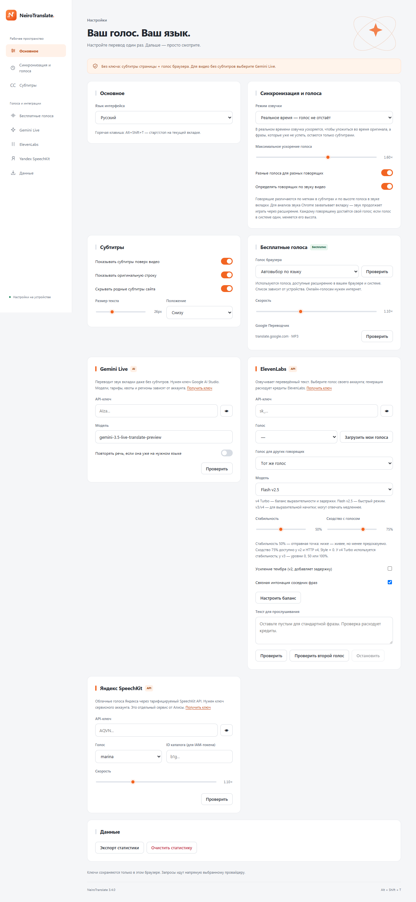
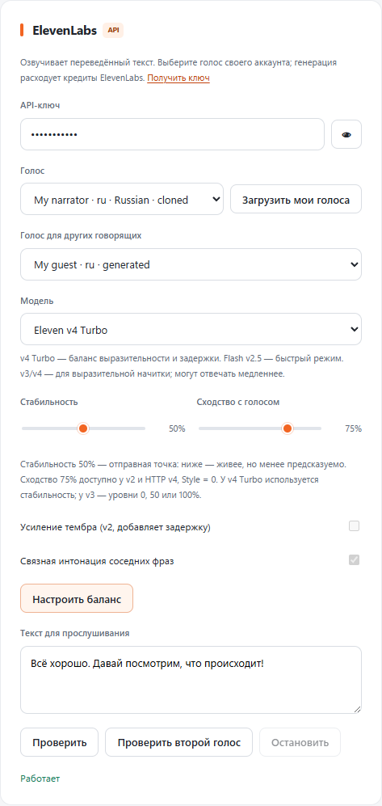
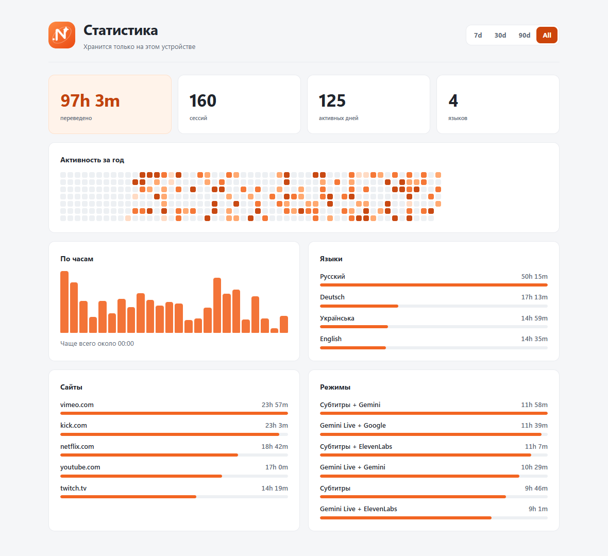

<p align="center"></p>

<h1 align="center">NeiroTranslate</h1>
<p align="center"><strong>Смотри видео на своём языке.</strong><br>Переведённые субтитры и озвучка для видео и прямых эфиров.</p>
<p align="center"><strong>v3.4.1</strong> · Chromium 116+ · Manifest V3 · Русский / English</p>
<p align="center"><a href="#установка">Установка</a> · <a href="#быстрый-старт">Быстрый старт</a> · <a href="#голоса-и-режимы">Голоса</a> · <a href="#скриншоты">Скриншоты</a> · <a href="docs/README.en.md">English</a></p>

---

NeiroTranslate — расширение для Chromium с бело-оранжевым интерфейсом и космическими деталями. Оно переводит доступные субтитры страницы или речь из звука вкладки, показывает перевод поверх видео и читает его выбранным голосом. Собственный сервер проекта и отдельная учётная запись NeiroTranslate не нужны.

| Смотри | Настраивай | Управляй |
| --- | --- | --- |
| Перевод и оригинал поверх видео | Браузерные голоса, Google, Gemini, ElevenLabs, SpeechKit | Пауза, перемотка и «Стоп» отменяют старую речь |
| Видео и эфиры с доступными CC | Несколько голосов для диалогов | Микшер приглушает оригинал во время озвучки |
| Перевод звука через Gemini Live | Темп речи и размер субтитров | Горячая клавиша **Alt+Shift+T** |

## Установка

Node.js и Python для использования расширения **не нужны**.

1. Скачай репозиторий через **Code → Download ZIP** или готовый `neirotranslate-3.4.1.zip`, если он приложен к релизу.
2. Распакуй архив.
3. Открой `chrome://extensions` или `edge://extensions` и включи **Режим разработчика**.
4. Нажми **Загрузить распакованное расширение** и выбери папку, в которой лежит `manifest.json`.
5. Закрепи значок NeiroTranslate на панели и открой страницу с видео.

После обновления перезагрузи **и расширение, и вкладку с видео**. Рядом с подготовленными ZIP создаются файлы `.zip.sha256` для проверки целостности.

## Быстрый старт

**Бесплатно, без API-ключей:**

1. Включи **CC** в плеере.
2. В NeiroTranslate выбери **Из субтитров** и язык перевода.
3. Выбери **Голос браузера**, **Google Переводчик** или **Только субтитры**.
4. Нажми **Начать перевод**. Повторное нажатие или **Alt+Shift+T** останавливает перевод.

> Бесплатному режиму нужны субтитры на странице. Если их нет, выбери **Из звука** и подключи собственный ключ **Gemini Live**. Бесплатный голос сам по себе не распознаёт речь.

## Голоса и режимы

Источник перевода и голос выбираются отдельно. Например, Gemini может переводить звук, а браузерный голос — читать готовый перевод.

| Вариант | Для чего | Условия |
| --- | --- | --- |
| **Из субтитров** | Перевод доступных CC / HTML5-дорожек | Без ключа; нужен интернет для перевода |
| **Из звука · Gemini Live** | Перевод речи вкладки, в том числе без CC | Ключ Gemini, доступ к Live-модели и квота аккаунта |
| **Голос браузера** | Системные и браузерные голоса | Бесплатно; доступные языки зависят от устройства |
| **Google Переводчик** | Озвучка переведённого текста | Без ключа; неофициальный веб-сервис может ограничивать запросы |
| **Gemini** | Переведённый голос Live-модели | Работает с источником **Из звука** |
| **ElevenLabs** | Выбранные голоса своего аккаунта | Ключ, Voice ID, доступ к модели и кредиты |
| **Яндекс SpeechKit** | Облачная озвучка Яндекса | Ключ сервисного аккаунта и тарификация SpeechKit |
| **Только субтитры** | Перевод без речи | Любой из двух источников |

<details>
<summary><strong>Как подключить провайдеров</strong></summary>

**Gemini.** Создай ключ в [Google AI Studio](https://aistudio.google.com/app/apikey), вставь его в настройки и нажми «Проверить». По умолчанию используется `gemini-3.5-live-translate-preview`; модель можно изменить. Бесплатное создание ключа не означает бесплатное использование любой модели. [Документация Live Translate](https://ai.google.dev/gemini-api/docs/live-api/live-translate).

**ElevenLabs.** Вставь ключ, нажми «Загрузить мои голоса» и выбери основной и, при желании, второй голос. Кнопка **«Настроить баланс»** выбирает v4 Turbo и 50% стабильности. Оба голоса можно прослушать на своём тексте и остановить генерацию. Проверки расходуют кредиты. Подробнее: [естественная озвучка и настройки моделей](docs/VOICE_QUALITY.md).

**Яндекс.** Укажи API-ключ сервисного аккаунта с доступом к SpeechKit. Реализован REST API v1: русский, английский, немецкий, казахский и узбекский. ID каталога нужен для пользовательского IAM-токена, а не для API-ключа. SpeechKit — отдельный тарифицируемый сервис; бесплатный чат Алисы не предоставляет бесплатную озвучку через этот API. [Документация SpeechKit](https://aistudio.yandex.ru/en/docs/speechkit/).

Доступность, регионы и лимиты определяют сами провайдеры. Ключи вводятся только в настройках собственного браузера.

</details>

## Синхронизация и говорящие

В режиме **«Реальное время»** озвучка подстраивает темп под окно фразы и отдаёт приоритет свежей речи. В режиме **«Полностью»** расширение старается озвучить каждую фразу, допуская отставание. Пауза, перемотка и остановка очищают старые запросы и звук; исходная громкость восстанавливается после речи.

В режиме **«Полностью»** принятые реплики сохраняются в порядке поступления после исчезновения субтитра. Максимум — 256 ожидающих и обрабатываемых реплик; при переполнении появляется сообщение об отставании. Пауза, перемотка, остановка и смена режима сбрасывают накопленную очередь.

Говорящие различаются по меткам субтитров (`<v Имя>`, `>>`, диалоговые тире, `ИМЯ:`) и, при включённом анализе, по высоте голоса в звуке вкладки. Анализ высоты выполняется **локально**. Для ElevenLabs можно задать второй голос; Google использует вариации высоты одного голоса. Это приблизительное разделение, без клонирования исходных людей: похожие голоса и музыка могут мешать.

Сетевой перевод и синтез требуют времени — **нулевая задержка не обещается**. Готовая дорожка позволяет подготовить следующую реплику заранее; на живом эфире будущих субтитров обычно нет. Если речь слишком быстрая, уменьши «Максимальное ускорение» или выбери режим «Полностью».

## Скриншоты

<p align="center"> </p>



<details>
<summary><strong>Настройки, ElevenLabs и история</strong></summary>



<p align="center"></p>



</details>

Скриншоты сняты в работающем расширении на тестовом видео и отдельном профиле. История и голоса на изображениях демонстрационные; личные ключи не используются.

## Данные и ключи

- В исходниках и релизах нет личных API-ключей. Настройки провайдеров по умолчанию пустые.
- Введённые ключи остаются в `chrome.storage.local` твоего браузера и не синхронизируются расширением.
- Текст и, в режиме Gemini, звук отправляются выбранным провайдерам напрямую. Собственной аналитики проекта нет.
- История хранит метаданные сессий, без текстов субтитров и аудиозаписей.
- Проверка секретов запускается в CI и перед сборкой архивов; локальные `.env`, кэши и результаты тестов не входят в поставку.

[Какие данные обрабатываются](docs/PRIVACY.md) · [Работа с ключами и сообщения о проблемах](SECURITY.md)

## Ограничения и помощь

Требуется Chromium 116+. Проверено в Chromium Playwright на Windows; совместимость с конкретным сайтом и голосом ОС зависит от их API. Firefox и Safari не поддерживаются. Сайт может изменить разметку CC; DRM, встроенные кросс-доменные плееры, Picture-in-Picture и native fullscreen могут ограничивать захват и оверлей.

| Что происходит | Что проверить |
| --- | --- |
| Нет бесплатного перевода | Есть ли CC и выбран ли источник «Из субтитров» |
| Есть текст, нет речи | Наличие голоса нужного языка, настройки громкости и кнопку «Проверить» |
| Озвучка отстаёт | Режим «Реальное время», качество сети и максимальное ускорение |
| Говорящие путаются | Отключи определение по звуку или использование разных голосов |
| Ошибка API | Текст ошибки, ключ, доступ к модели, регион и квоты аккаунта |

При сообщении о баге укажи версию, браузер, сайт, источник и голос. **Не прикладывай ключи или личные данные.**

## Разработка

Расширение работает прямо из исходников, без сборки интерфейса, CDN и удалённых шрифтов.

```sh
node tools/check-secrets.mjs --history
node tools/check.mjs
node --test --test-timeout=10000 tests/*.test.js
```

Браузерные проверки используют изолированные профили, видео и WebAudio; внешние сервисы по умолчанию заменены управляемыми ответами. Реальные сетевые и платные проверки запускаются отдельно.

```sh
python tools/package.py           # расширение + SHA256
python tools/package.py --source  # исходники для GitHub + SHA256
```

Архив **`-source.zip`** содержит код, тесты, инструменты, CI и документацию. Обычный ZIP предназначен для установки расширения. Ни один не содержит `.git`, локальные результаты тестов или профили браузера.

[Инструкция разработчика](CONTRIBUTING.md) · [Результаты проверок](docs/VERIFICATION.md) · [Code review](docs/CODE_REVIEW.md) · [История изменений](CHANGELOG.md)
