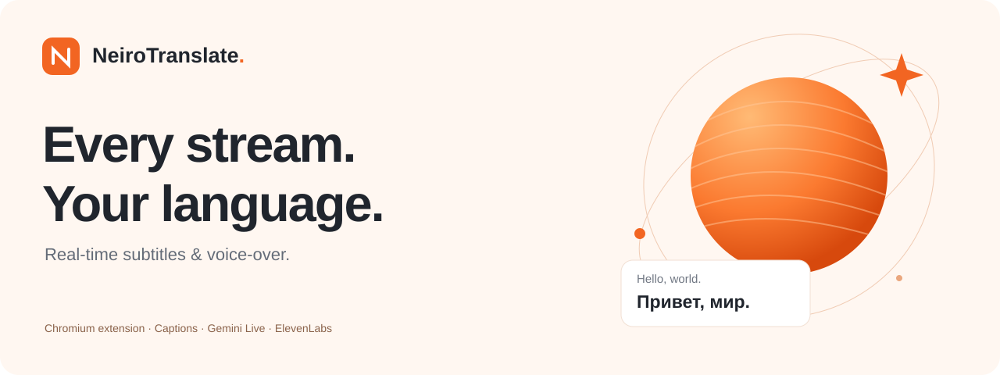
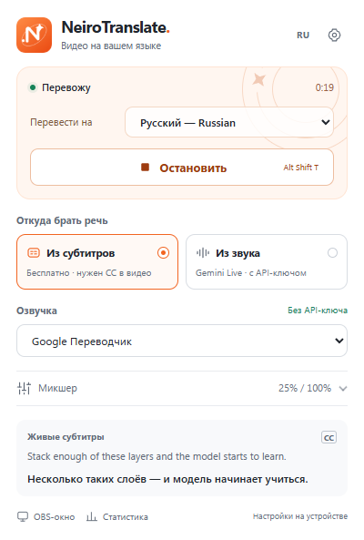
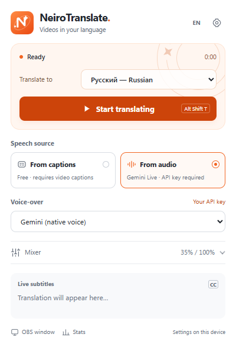
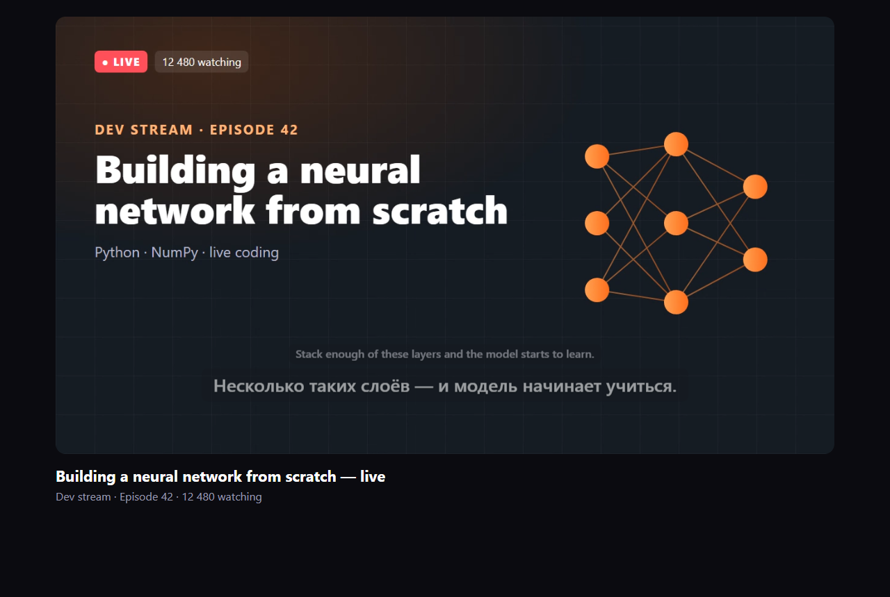
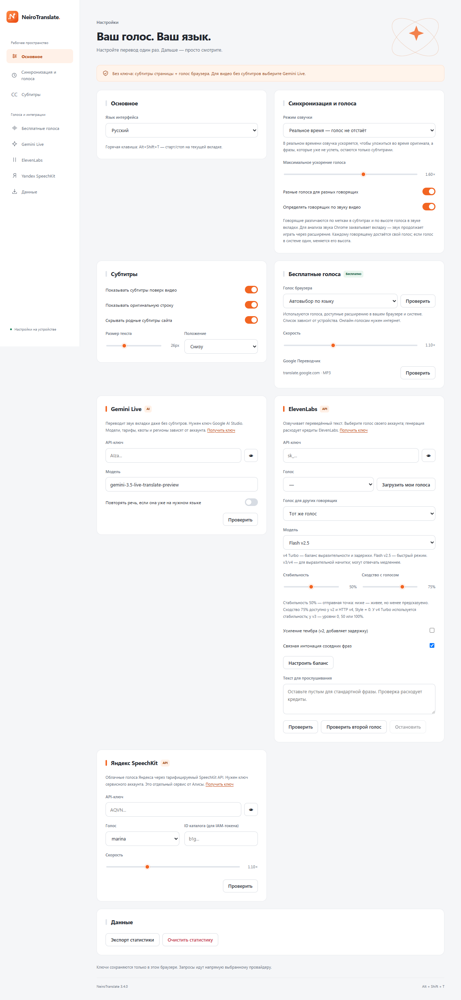
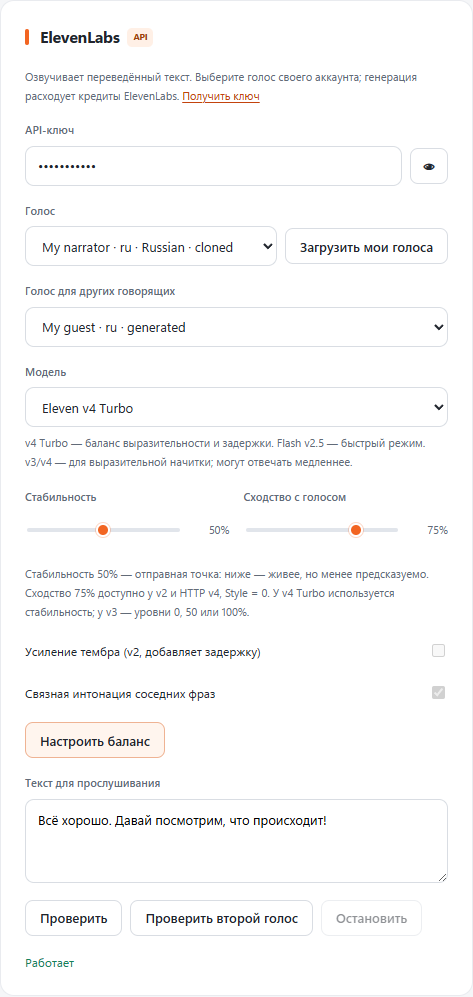

<p align="center"></p>

<h1 align="center">NeiroTranslate</h1>
<p align="center"><strong>Watch in your language.</strong><br>Translated subtitles and voice-over for videos and live streams.</p>
<p align="center"><strong>v3.4.0</strong> · Chromium 116+ · Manifest V3 · Russian / English</p>
<p align="center"><a href="../README.md">Русский</a> · <a href="#install">Install</a> · <a href="#voices-and-sources">Voices</a> · <a href="../CONTRIBUTING.md">Development</a></p>

---

NeiroTranslate reads available page captions or translates tab audio with Gemini Live. It overlays the translation and speaks it with your chosen voice. The extension has a white/orange orbital interface, no project backend and no separate NeiroTranslate account.

## Install

1. Download the repository using **Code → Download ZIP**, or use `neirotranslate-3.4.0.zip` if attached to a release.
2. Extract it, open `chrome://extensions` / `edge://extensions` and enable **Developer mode**.
3. Select **Load unpacked** and choose the folder containing `manifest.json`.
4. Pin the extension and open a video page. Reload both the extension and the video tab after an update.

Node.js and Python are not needed to use the extension. Release ZIPs have separate `.zip.sha256` checksums.

## Quick start

For free translation, enable the video's **CC**, choose **From captions**, select your target language and **Browser voice**, **Google Translate** or **Subtitles only**. Press **Start translating** or **Alt+Shift+T**. The same shortcut stops translation.

> Free mode needs page captions. For video without captions, select **From audio** and provide your own Gemini Live key. A free voice does not provide speech recognition.

## Voices and sources

Source and voice are separate. Gemini can translate audio while a browser voice speaks the translated text.

| Option | Requirements |
| --- | --- |
| **From captions** | Available CC / HTML5 tracks; no API key; internet for translation |
| **From audio · Gemini Live** | Your key, Live-model access and account quota |
| **Browser voice** | Free; languages and online/offline voices depend on the browser and OS |
| **Google Translate voice** | No key; unofficial endpoint with possible rate limits |
| **Gemini voice** | Native translated audio, with the **From audio** source |
| **ElevenLabs** | Your key, Voice ID, model access and credits |
| **Yandex SpeechKit** | Metered cloud API; service-account key |
| **Subtitles only** | No speech synthesis; either translation source |

Configure providers in Settings. Gemini's default is `gemini-3.5-live-translate-preview`. ElevenLabs **Use balanced settings** selects v4 Turbo with 50% stability; preview both voices with your own text and cancel with Stop. Generation and tests may consume credits. SpeechKit is separate from the Alice app and supports the implemented v1 languages: Russian, English, German, Kazakh and Uzbek.

Provider access, regions and billing depend on the account. References: [Gemini Live Translate](https://ai.google.dev/gemini-api/docs/live-api/live-translate), [ElevenLabs streaming](https://elevenlabs.io/docs/api-reference/text-to-speech/stream), [SpeechKit](https://aistudio.yandex.ru/en/docs/speechkit/). [Voice-quality guide (Russian)](VOICE_QUALITY.md).

## Timing and speakers

**Real time** adapts speech to cue timing and prioritizes fresh lines. **Complete** aims to speak every line and can fall behind. Pause, seek and Stop cancel old work; original volume is restored after speech. Network translation and synthesis take time, so zero latency is not promised.

Speakers are separated using caption labels and, optionally, local pitch analysis. Browser voices can use different installed voices; Google varies one voice's pitch; ElevenLabs offers a second selected voice. Similar voices and background music can confuse pitch analysis. This is approximate separation, not voice cloning.

## Screenshots

<p align="center"> </p>



<details>
<summary><strong>Settings and voice controls</strong></summary>



<p align="center"></p>

</details>

Screenshots use an isolated test profile and demonstration data, with no personal keys.

## Data and limitations

Keys are empty by default and stay in local browser storage when entered. They are not included in the repository, archives or statistics export. Text and, in Gemini mode, tab audio go directly to the selected providers. Local speaker analysis sends no audio. There is no project analytics backend.

Chromium 116+ is required; Firefox and Safari are unsupported. Site caption markup, OS voices, DRM, cross-origin players, native fullscreen and Picture-in-Picture can affect compatibility. Region, quota and model errors remain possible. See [Privacy](PRIVACY.md) and [Security](../SECURITY.md).

## Development

```sh
node tools/check-secrets.mjs --history
node tools/check.mjs
node --test --test-timeout=10000 tests/*.test.js
python tools/package.py
python tools/package.py --source
```

The source ZIP includes tests, tools, CI and documentation; the regular ZIP is for installation. Both exclude Git metadata, local profiles, caches and test output. Credential checks run before packaging and in CI. Browser tests use provider fixtures by default; live provider checks are opt-in.

[Contributing](../CONTRIBUTING.md) · [Verification](VERIFICATION.md) · [Code review](CODE_REVIEW.md) · [Changelog](../CHANGELOG.md)
