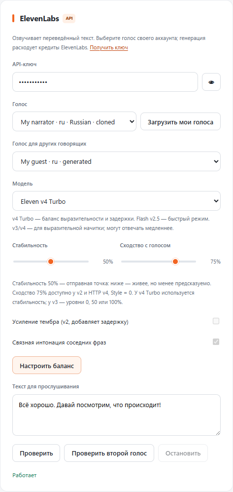

# Естественная озвучка ElevenLabs

В NeiroTranslate выберите **Настройки → ElevenLabs → Настроить баланс**. Это выбирает **Eleven v4 Turbo** и стабильность **50%**. Пресет также сохраняет сходство **75%** для HTTP-моделей, которые поддерживают этот параметр, и отключает усиление тембра. Ваши ключ и выбранные голоса сохранятся. Нужны доступ к модели и кредиты аккаунта; сам выбор пресета не запускает генерацию.

## Выбор и прослушивание

Нажмите «Загрузить мои голоса» и выберите основной голос. Расширение показывает язык и акцент, если ElevenLabs их вернул. Список не выбирает первый голос автоматически. Для нескольких говорящих выберите отдельный «Голос для других говорящих».

Вставьте короткую типичную реплику в «Текст для прослушивания». Кнопки «Проверить» и «Проверить второй голос» используют этот текст, выбранную модель и настройки. Пустое поле использует стандартный пример. Проверка расходует кредиты; «Остановить» отменяет запрос и звук. Изменение голоса или модели также отменяет незавершённое прослушивание.

Голос с подходящим языком, акцентом и манерой речи обычно полезнее дополнительных эффектов. Популярность Adam, Brian или Liam сама по себе не делает их некачественными; выбирайте по звучанию на своих репликах. Можно использовать доступный в аккаунте Voice Design или свой клон, затем загрузить его в список расширения. Пример описания для Voice Design:

> Native Russian speaker. Warm, conversational adult voice, clear articulation, relaxed natural delivery, subtle emotional variation.

Создание и клонирование выполняются в ElevenLabs, расширение не создаёт клон автоматически.

## Модели и настройки

| Модель | Применение | Поддерживаемые настройки в расширении |
| --- | --- | --- |
| Eleven v4 Turbo | Баланс выразительности и скорости для видео и стримов | Стабильность; потоковый Text to Dialogue WebSocket |
| Flash v2.5 | Приоритет минимальной задержки | Стабильность, сходство, усиление тембра, API-скорость |
| Turbo v2.5 / Multilingual v2 | Альтернативы для выбранного голоса | Стабильность, сходство, усиление тембра, API-скорость |
| Eleven v4 | Выразительная начитка с возможным увеличением ожидания | Стабильность, сходство |
| Eleven v3 | Выразительная начитка | Стабильность: 0%, 50% или 100%; ползунок округляется к ближайшему уровню |

Начните с 50% стабильности и 75% сходства. Если речь монотонна, немного уменьшите стабильность; если интонация непредсказуема — увеличьте. Высокое сходство может переносить недостатки исходной записи. У моделей v2 `style` всегда равен нулю; усиление тембра по умолчанию отключено, поскольку оно добавляет вычисления и задержку. У v3/v4 эти параметры не отправляются.

Настройки зависят и от транспорта: общий обзор v4 упоминает сходство, но опубликованная схема Text to Dialogue WebSocket объявляет `stability` и `clone_strength`, без `similarity_boost`. Поэтому в v4 Turbo расширение отправляет только стабильность; сходство отключено в интерфейсе. Это следование документированной схеме, а не подтверждение того, как платный API обрабатывает дополнительные поля.

Для HTTP-моделей «Связная интонация соседних фраз» передаёт только последнюю успешно завершённую фразу того же говорящего, голоса, языка и модели как `previous_text`. Текст не повторяется вслух: он используется как контекст. В памяти остаётся до 100 символов на восемь секунд, без записи на диск. Пауза, перемотка, остановка, смена настроек или прерывание очищают контекст. Для v4 Turbo эта настройка отключена: его WebSocket не использует этот параметр.

Озвучка всё ещё подстраивается под время оригинала. У v2 API-скорость ограничена диапазоном 0,7–1,2; остаточная коррекция выполняется локально. У v3/v4 нет API-параметра скорости, поэтому используется локальная коррекция. Слишком сильное ускорение ухудшает естественность независимо от модели. Если речь торопится, уменьшите «Максимальное ускорение голоса». Режим «Полностью» уменьшает пропуски, но допускает отставание от видео.

Если поток требует локального ускорения, звук собирается в одинаковые блоки по 120 мс с 40 мс контекста анализа. Первый блок требует до 160 мс входного звука, а не всю фразу. Плавные переходы сглаживают стыки; перекрытие учитывается в длительности, контекст не повторяется. Случайный размер сетевых пакетов не переключает речь между сохранением и повышением высоты голоса. Короткий хвост звучит на исходной высоте и скорости. Без локальной коррекции дополнительный запас не нужен.

## Текст и эмоции

Расширение сохраняет пунктуацию и букву «ё», не добавляет эмоциональные теги и не заменяет слова по догадке. По субтитрам нельзя надёжно восстановить сарказм, шёпот или смех исходного человека. Разделение говорящих также не является переносом эмоций или клонированием их голосов.

Для ручной проверки v3/v4 можно использовать поддерживаемые моделью английские теги, например `[whispering]`. Не переносите эти теги на Flash/Multilingual без проверки: разные семейства моделей обрабатывают их по-разному. Добавленные теги и длинные паузы способны увеличить длительность речи и отставание. Перебор дублей и speech-to-speech полезны для подготовленной записи; автоматический перебор дублей каждого live-субтитра создаст лишние расходы и ожидание.

Числа, даты и омографы требуют контекста. Автоматическая подстановка «ё», ударений или преобразование всех чисел словами может исказить смысл. Flash v2.5 имеет ограничения нормализации; NeiroTranslate не включает принудительную платную/Enterprise-нормализацию и не обещает безошибочное чтение любой даты.

## Тарифы и границы проверки

Кредиты и коммерческие права определяются вашим тарифом ElevenLabs. Клон своего голоса не отменяет условия тарифа. Проверяйте [актуальные тарифы](https://elevenlabs.io/pricing) перед публикацией монетизируемого материала. Разовые акции и скидки первого месяца не являются обычной стоимостью подписки.

Интеграция проверяется на управляемых HTTP/WebSocket-ответах и настоящем WebAudio. Это подтверждает параметры, последовательность звука, ошибки и отмену, но не оценивает качество платной генерации на вашем голосе. Дополнительный запрос с предоставленным ключом ElevenLabs получил региональное ограничение; это не результат проверки действительности ключа. Для оценки естественности нужны доступ к сервису и прослушивание. Запросы могут быть недоступны из-за сети, региона, квот или прав модели. Время инференса модели из рекламы не равно задержке «субтитр → слышимый голос».

Официальные источники, проверены 29 октября 2026:

- [Модели ElevenLabs](https://elevenlabs.io/docs/overview/models).
- [Настройки голосов](https://elevenlabs.io/docs/api-reference/voices/settings/update).
- [HTTP Streaming TTS и previous_text](https://elevenlabs.io/docs/api-reference/text-to-speech/stream).
- [Text to Dialogue WebSocket: аутентификация, flush, is_final](https://elevenlabs.io/docs/api-reference/text-to-dialogue/ttd-websocket).
- [Потоковый диалог и короткие реплики](https://elevenlabs.io/docs/eleven-api/guides/how-to/websockets/realtime-tdd).
- [Модели и параметры речи](https://elevenlabs.io/docs/eleven-creative/playground/text-to-speech).
- [Пунктуация, эмоции и ограничения моделей](https://elevenlabs.io/docs/overview/capabilities/text-to-speech/best-practices).

